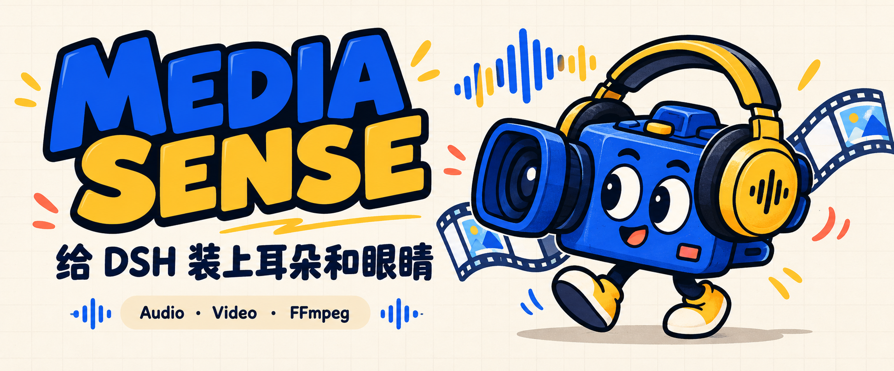
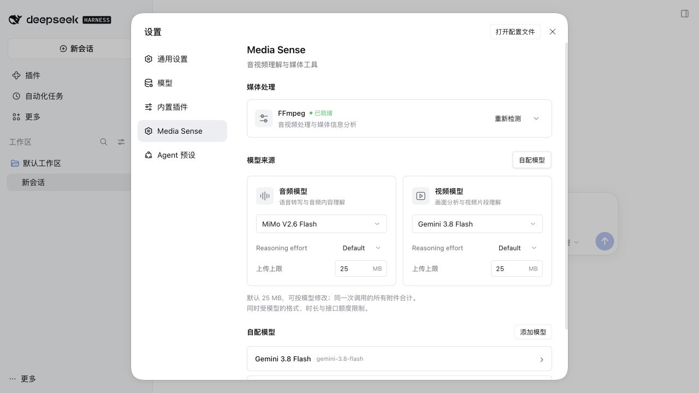
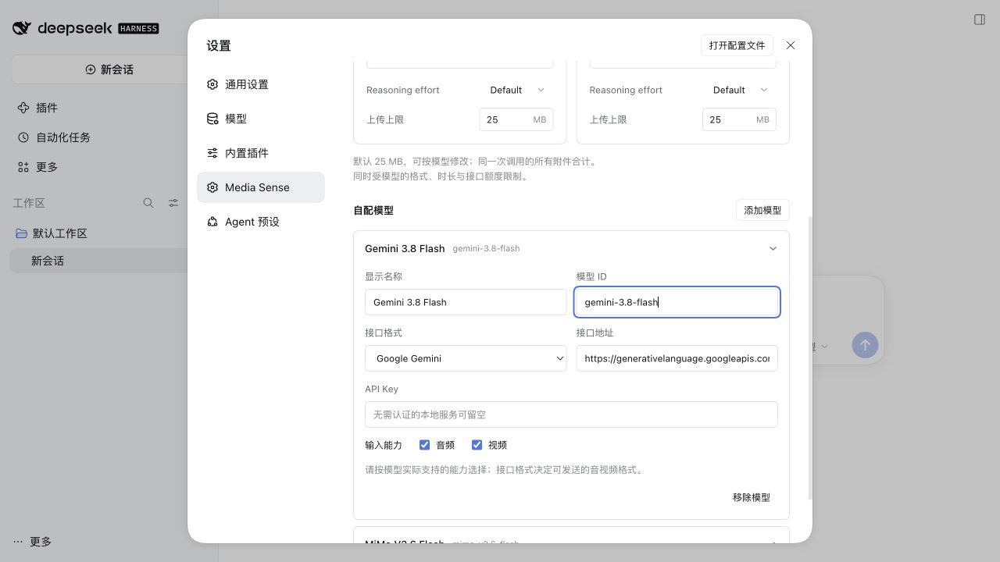

<p align="center">
  <strong>录音太长？视频懒得拖？交给 DSH 听一听、看一看。</strong><br>
  DeepSeek Harness 的音视频理解插件 · Web / Desktop
</p>

<p align="center">
  <a href="#三步开用">开始使用</a> ·
  <a href="#模型怎么选">模型推荐</a> ·
  <a href="docs/setup.md">配置手册</a> ·
  <a href="docs/development.md">开发文档</a>
</p>

## 把素材丢给它，剩下的用一句话说

| 你手里的东西 | 可以这样问 DSH |
| --- | --- |
| 🎙️ 一段会议录音 | 「整理决定了什么、谁来做，听不清的地方标出来。」 |
| 🎬 一段产品演示 | 「按时间线讲讲操作步骤，找出最适合做封面的画面。」 |
| 🎧 一段采访 | 「转成文字，区分说话人，再给我一版精简摘要。」 |
| 🧰 待处理的素材 | 「先检查 FFmpeg 和 FFprobe，缺了就帮我装好。」 |

Media Sense 把本地音视频交给你选择的模型，返回文字结果。音频和视频可以各选一个模型，FFmpeg 也有独立的检测、安装入口。

## 它在 DSH 里长这样



*实机截图：DSH 0.2.1-rc.5，独立演示配置。模型名称为配置示例，API Key 留空。*

## 三步开用

**① 装进 DSH**

桌面版打开侧栏 **插件 → 添加插件**，填入以下 GitHub 来源，安装后启用 Media Sense：

```text
github:xhznAI/media-sense#v0.1.0
```

浏览器版也可以在终端安装：

```sh
dsh plugin --profile web add github:xhznAI/media-sense#v0.1.0
```

按 DSH 提示重启，然后进入设置。无需 npm 账号，发布版本已包含编译文件。[离线安装与更新说明](docs/setup.md#安装)

**② 选好耳朵和眼睛**

打开 **设置 → Media Sense → 添加模型**，填写模型 ID、接口地址和 API Key，选择接口格式与输入能力。然后分别选中音频模型、视频模型，保存。

**③ 开始提问**

把素材放进 DSH 工作区，告诉它文件在哪里、你想知道什么。例如：

> 用 Media Sense 分析 `demo.mp4`，按时间线列出主要画面，并标出值得回看的片段。

<details>
<summary>展开看看：添加模型时要填什么</summary>



显示名称可以随意取；**模型 ID 要使用服务商提供的准确名称**。接口格式要与服务商实际实现相符，“兼容 OpenAI”不代表所有音视频扩展都通用。

</details>

## 模型怎么选

下表按插件中的 **接口格式名称** 对应。模型 ID 可以复制；链接指向厂商文档。

| 接口格式 | 推荐从这些模型开始 | 本插件可发送的素材 |
| --- | --- | --- |
| **Google Gemini** | [`gemini-3.8-flash`](https://ai.google.dev/gemini-api/docs/models/gemini-3.8-flash) | 🎧 音频 · 🎬 视频 |
| **OpenAI Chat Completions** | [`gpt-audio-1.5`](https://developers.openai.com/api/docs/models/gpt-audio-1.5) | 🎧 WAV / MP3 音频 |
| **Qwen Omni** | [`qwen3.8-omni-flash`](https://help.aliyun.com/zh/model-studio/qwen-omni) | 🎧 音频 · 🎬 视频 |
| **MiMo Omni** | [`mimo-v2.6-flash`、`mimo-v2.6-pro`](https://mimo.mi.com/docs/en-US/quick-start/usage-guide/multimodal-understanding/video-understanding) | 🎧 音频 · 🎬 视频 |
| **Kimi Video** | [`kimi-k3.1-pro`、`kimi-k2.6`](https://platform.kimi.com/docs/guide/use-kimi-vision-model) | 🎬 视频画面 |
| **GLM Video** | [`glm-4.6v`](https://docs.bigmodel.cn/cn/guide/models/vlm/glm-4.6v)（兼容性待验证） | 🎬 视频画面，见下方说明 |

想先接一个同时处理音频和视频的模型，可以从 **Gemini、Qwen Omni 或 MiMo** 中选你已有账号的一家。只接 OpenAI 音频时，请选支持音频输入的型号，普通聊天模型不能替代。

**GLM 的例外：** 当前插件直接发送本地视频的 Base64；智谱的官方资料对视频 Base64 支持存在差异，部分只列 URL。`glm-4.6v` 暂列候选，接入前需验证所用服务端。[详情与依据](docs/setup.md#glm-视频的兼容性边界)

*推荐依据为厂商文档，核对于 2026-10-31；未逐个进行付费推理实测。可用型号、格式和额度以你的服务商账号为准。接口地址见[配置手册](docs/setup.md#接口地址)。*

## 几个容易踩的小坑

### 视频模型能听见视频里的声音吗？

要看具体模型。Kimi Video、GLM Video 在本插件中用于画面理解，不能据此假定支持声音理解。需要分析对白或环境音时，选支持对应输入的模型；必要时先用 FFmpeg 提取音频。

### 大文件能直接扔进去吗？

默认每次合计 **25 MB**，可以在模型卡片中调整。服务商的请求体、时长和上下文限制仍然有效；长素材建议先裁剪。插件不会自动压缩或切片。[额度说明](docs/setup.md#文件大小与格式)

### 写着 Web，桌面版能用吗？

能。DSH 桌面版承载同一套 Web 界面，因此插件元数据使用 `platform: web`，覆盖浏览器与桌面客户端。本插件不提供纯 CLI 界面。

---

## Acknowledgements

感谢以下项目的维护者与贡献者：

- [DeepSeek Harness](https://github.com/deepseek-ai/deepseek-harness)：Media Sense 的宿主，提供插件系统、工具接口和 Web / Desktop 界面。
- [FFmpeg](https://ffmpeg.org/) 与 [ffmpeg-static](https://github.com/eugeneware/ffmpeg-static)：提供音视频处理工具与跨平台二进制分发。

也推荐关注 DSH 社区的语音项目：

- [WizisCool/dsh-ears](https://github.com/WizisCool/dsh-ears)：语音输入与文字润色，支持本地 Whisper 和语音识别 API。
- [haoku123/dsh-voice](https://github.com/haoku123/dsh-voice)：全双工语音交互，结合 SenseVoice 识别与 TTS 朗读，支持语音打断。

---

🛠️ [独立开发与宿主接入](docs/development.md) · 🔐 [文件与 Key 如何处理](docs/setup.md#文件与-key) · 🎨 [图片来源](docs/images/README.md)

Made by [zhoufeiyu · xhznAI](https://github.com/xhznAI) · [MIT License](LICENSE)
